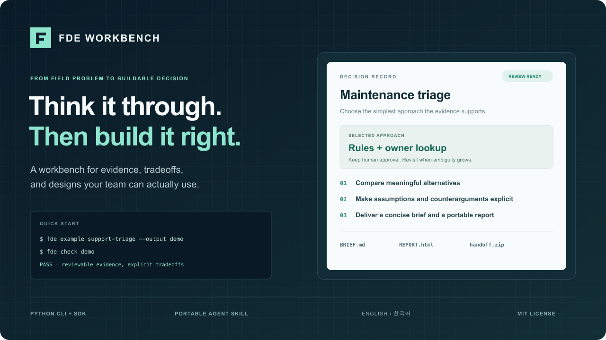
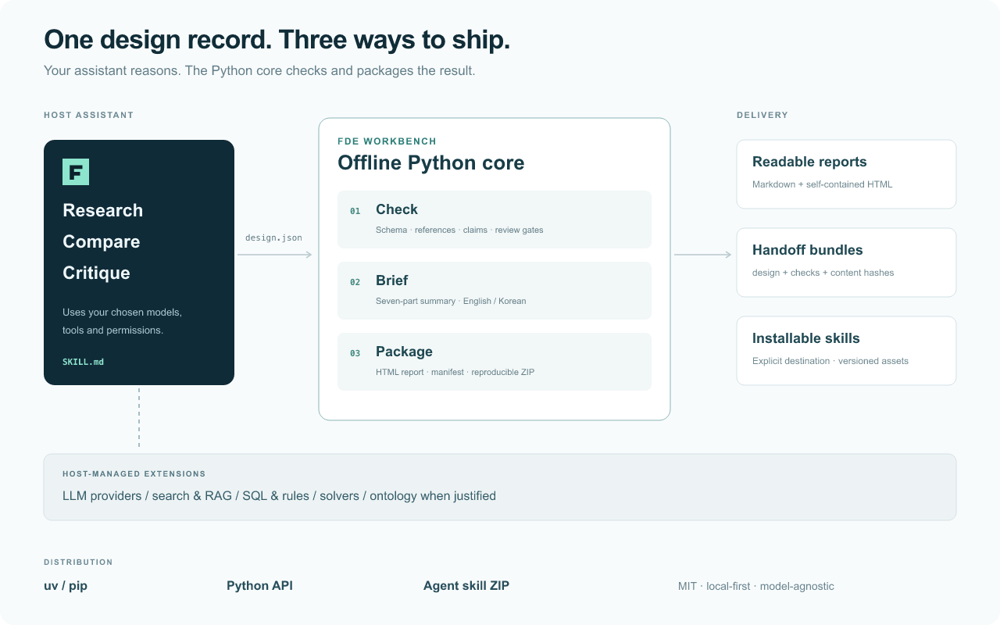

<p align="center">
  <a href="README.md">English</a> · <a href="README.ko.md"><strong>한국어</strong></a>
</p>

<p align="center">
  
</p>

<p align="center">
  <a href="https://github.com/daehuikim/fde-service-template/actions/workflows/python.yml"></a>
  <a href="https://github.com/daehuikim/fde-service-template/releases"></a>
  
  <a href="LICENSE"></a>
</p>

**현장의 복잡한 문제를 짧은 검토 초안, 근거 있는 기술 선택, 구현할 수 있는 설계로 연결합니다.**

FDE Workbench는 설치형 agent skill과 오프라인 Python CLI·라이브러리를 제공합니다. 어시스턴트가 조사·비교·비판을 수행하고, 패키지가 근거 연결을 검사해 읽기 쉬운 결과물을 만듭니다. 규칙·SQL·검색·최적화·LLM·온톨로지는 문제와 자료에 맞을 때 선택합니다.

[빠른 시작](#빠른-시작) · [사용 가이드](docs/ko/guide.md) · [CLI·Python API](docs/ko/api.md) · [구조](#어떻게-동작하나요) · [릴리스](https://github.com/daehuikim/fde-service-template/releases)

## 빠른 시작

[uv](https://docs.astral.sh/uv/)로 버전을 고정해 설치합니다.

```sh
uv tool install "git+https://github.com/daehuikim/fde-service-template.git@v0.2.0"
```

또는 사용 중인 Python 환경에 pip로 설치합니다.

```sh
pip install "git+https://github.com/daehuikim/fde-service-template.git@v0.2.0"
```

완성된 합성 예제를 실행해 보세요.

```sh
fde example support-triage --output demo --lang ko
fde check demo
fde brief demo --lang ko
fde export demo --output review --lang ko
```

`review/REPORT.html`을 열면 근거·대안·비판이 포함된 보고서를 읽을 수 있습니다. 위 명령에는 Node·API key·모델 endpoint가 필요하지 않습니다. [wheel·소스 배포본·skill ZIP](https://github.com/daehuikim/fde-service-template/releases/tag/v0.2.0)으로도 설치할 수 있습니다. 현재 배포 채널은 GitHub이며 PyPI 게시는 별도 설정 대상입니다.

## 짧은 초안부터, 필요한 만큼 깊게

먼저 **배경 → 페인포인트 → 소구점(가설) → 기술 조합 → 확장 조건 → 가장 강한 반론 → 다음 확인**의 초안을 만듭니다. 상세 설계는 이후에 요구사항·근거·대안·실패 시나리오를 연결하며 확장합니다.

| 기능 | 제공하는 결과 |
|---|---|
| **문제 정의** | 바꿀 결정, 현재 업무, 담당자, 가정과 범위 |
| **기술 대안 비교** | 작동 방식, 필요한 자료, 실패 조건과 기각 이유 |
| **다각도 비판** | 사용자·자료·비용·보안·운영 관점과 잔여 위험 |
| **설계 문서 검사** | JSON Schema, 근거·시나리오 참조, 주장 구분과 검토 조건 |
| **결과물 배포** | Markdown·오프라인 HTML·검사 결과·해시가 있는 ZIP |
| **Agent 연동** | 선택한 폴더에 설치되는 독립형 skill |
| **한·영 지원** | 문서·출력 제목·한국어/영어로 작성된 합성 예제 |

자동 검사는 문서 구조와 연결을 확인합니다. 근거의 진실성·방법의 적합성·사용자 가치는 별도 검토가 필요합니다. CLI가 설계를 자동 생성하거나 LLM을 호출하지는 않으며, skill이 사용 중인 어시스턴트의 조사·설계 작업을 안내합니다.

## 어떻게 동작하나요?



핵심은 **설계 기록 하나를 받아 검토 가능한 결과물로 내보내는 작은 코어**입니다. 모델·조사 도구·자료 접근은 호스트 어시스턴트가 관리합니다. [기술 용어와 선택 기준](docs/technology-glossary.md)에서 온톨로지·하네스·provider·RAG·workflow·agent의 역할과 한계를 확인할 수 있습니다.

## Agent에 설치하기

```sh
fde skill install --directory .agents/skills
```

어시스턴트에게 다음처럼 요청합니다.

> FDE Workbench로 이 현장 문제를 검토해 줘. 짧은 초안부터 주고, 관련 대안과 가정을 비판적으로 비교한 뒤 설계 인계까지만 진행해 줘.

설치기는 `fde-workbench/SKILL.md`, 설계 계약, 방법 선택 참고 자료, 검토 관점 자료를 추가합니다. 전역 설정을 바꾸거나 기존 skill을 덮어쓰지 않습니다. 릴리스의 skill ZIP을 사용하는 agent의 skills 폴더에 풀어도 됩니다. [Skill 가이드](docs/ko/guide.md#skill-설치)

### 현장 작업용 검토 기능

문제 설계 외에도 이름으로 바로 요청할 수 있는 검토 관점이 들어 있습니다.

| 요청 | 결과 |
|---|---|
| 오픈소스·상용 솔루션 **기능 해체 분석** | 모듈별 메커니즘·전제·한계·lock-in·근거 등급, 모듈마다 채택/통합/자체 구현/제외 결정 |
| **호환성·배포 확장성 검토** | 버전·플랫폼 호환 표면, 확장 한계와 그 신호, 유지/조건부 유지/변경 결론 |
| **검증 방법 검토** | 테스트가 주장을 실제로 증명하는지, 도달한 검증 수준, 증명된 범위로 다시 쓴 주장 |
| **고객 환경 매칭 배포 검토** | 고객 OS·커널·런타임·Kubernetes·네트워크 조건에 맞춘 배포 형태와 이미지 기준 |
| **현장 장애 진단, 보안·데이터 경계, 비용 모델** | 환경 차이표와 가설 소거, 데이터 흐름과 외부 전송 목록, 단위 비용·민감도·손익분기 |

이 저장소에는 같은 기능의 프로젝트 skill과 읽기 전용 고객 환경 수집 스크립트도 있습니다. [Skill 목록](.agents/skills/README.md)을 참고하세요.

## Python 코드에서 사용하기

```python
from pathlib import Path
from fde_workbench import check_design, export_report
import json

pack = json.loads(Path("demo/design.json").read_text())
result = check_design(pack)
if result.status == "pass":
    export_report(pack, Path("review"), lang="ko")
```

`fde bundle demo --output handoff.zip`은 같은 설계를 다른 팀에 인계할 수 있는 ZIP을 만듭니다. 설계·초안·보고서·검사 결과·SHA-256 manifest가 포함됩니다. [API와 종료 코드](docs/ko/api.md)

## 검증과 릴리스

```sh
uv sync --frozen
uv run ruff check src tests
uv run pytest
uv build
uv run twine check dist/*
```

Python CI는 Linux·macOS·Windows에서 설치와 CLI 동작을 검사합니다. 릴리스 절차는 wheel·sdist·버전이 고정된 skill ZIP을 만듭니다. [PyPI trusted publishing](docs/ko/releasing.md)은 소유자의 배포 환경 연결이 필요합니다. [선택형 웹서비스 예제](docs/en/web-example.md)는 Python 코어와 별도로 사용할 수 있습니다.

[변경 기록](CHANGELOG.md) · [기여](CONTRIBUTING.md) · [보안](SECURITY.md) · [라이선스](LICENSE) · [레퍼런스 검토](docs/product/reference-review.md)
